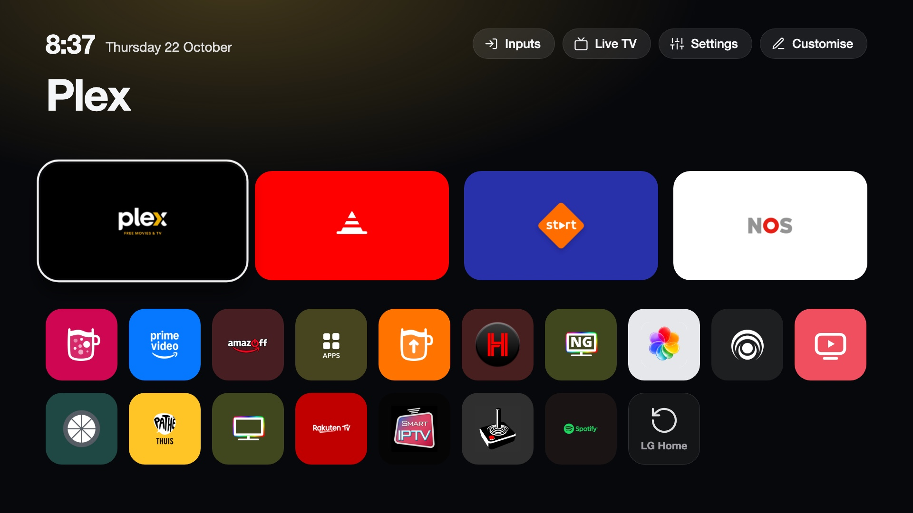
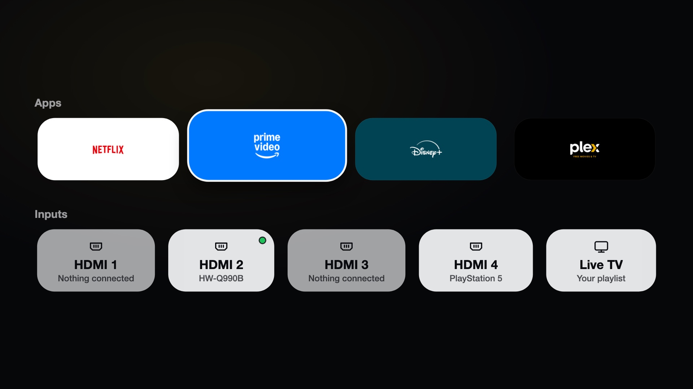

# CleanYourTV for LG webOS

A fast home screen for rooted LG webOS TVs. It replaces LG's Home with a dock of four apps, a top shelf and an app grid,
and adds Live TV from your own playlist, an Inputs list on the Input key, picture notifications from your network, optional
on-device voice recognition, and an optional debloat of LG's ads and telemetry.

## What it does

- **Launcher.** A dock of four apps, a top shelf with the focused app's name and an ambient glow, an app grid sorted by how often
  you use each app, an Inputs picker, a Settings shortcut and a clock. [More](launcher.md).
- **Live TV.** Plays your M3U playlist with a channel list, a programme guide (XMLTV) and number entry. It does not use LG's
  tuner. [More](live-tv.md).
- **Input key.** The remote's Input button opens an Inputs list over the running app. [More](input-key.md).
- **Picture notifications.** A card with a photo over whatever is on screen, triggered from your network, for example by
  Home Assistant. [More](notifications.md).
- **Voice (optional).** Speech recognition on the TV (Moonshine), with answers from Home Assistant's Assist, a language model through
  OpenRouter or your own server, shown as text. [More](voice.md).
- **Debloat.** Stops LG's ad and telemetry services and blocks a few ad servers. [More](debloat.md).
- **Manager app.** Sets up, updates and removes everything from the TV. [More](manager.md).

LG's system files are not modified. The launcher takes over Home with a mount that exists only in RAM, so a reboot without the
boot scripts brings LG's Home back. Everything we install is stored in `/media/developer/cleanyourtv` (plus two boot scripts and the
key binds), and the uninstall removes it. The project has no server or account and collects no data; optional features contact the
services you choose (update checks go to GitHub). See [What it changes on the TV](tv-changes.md) and [Security](security.md).

## Compatibility at a glance

| | |
|---|---|
| Needs | An LG webOS TV that is **rooted** with the Homebrew Channel, and SSH access as `root` for the install command. |
| webOS | **webOS 5 and newer** (2020 models and later). webOS 4 and older have no systemd and an old Node.js; setup stops before it changes anything. |
| Tested | LG OLED65G26LA on webOS 25. Other TVs are reported in [Tested TVs](tested-tvs.md). |
| Not needed | A computer app, a server, a cloud account. The service runs on the TV. |

!!! warning "This modifies a TV with root access"
    Read `install.sh` and the scripts it installs before you run them, and use the project at your own risk. The setup saves
    the original state, and a failed start restarts the TV with LG's Home, but nothing here is covered by a warranty.

## Screenshots

| | |
|---|---|
|  |  |
|  |  |
|  |  |
|  | |

## Where to start

1. Make sure the TV is rooted and has the Homebrew Channel ([rootmy.tv](https://rootmy.tv)).
2. Follow [Installing](install.md): one command from your computer, then **Set up now** in the app on the TV.
3. Check the [tested TVs](tested-tvs.md) and report yours if it is not listed.

## Disclaimer

CleanYourTV is an independent project. It is not affiliated with, endorsed by or supported by LG Electronics. LG and webOS are
trademarks of LG Electronics. Live TV plays only the playlists you add; the project provides no channels and no playlist.

## Licence

MIT. See [Credits and licences](credits.md) for the components that come with the package and their licences.
