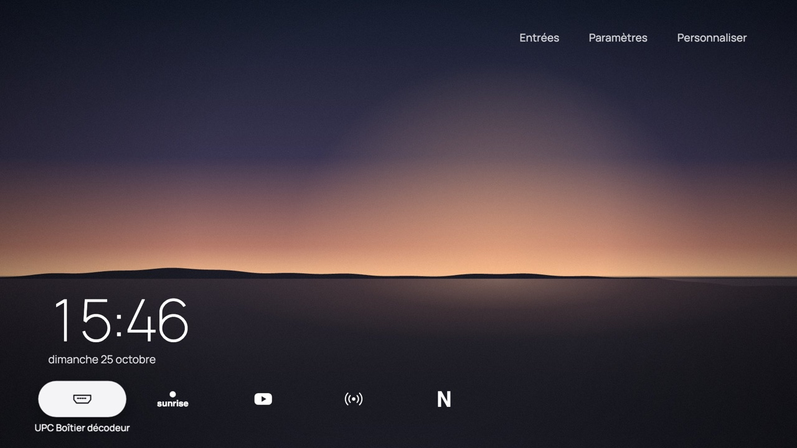
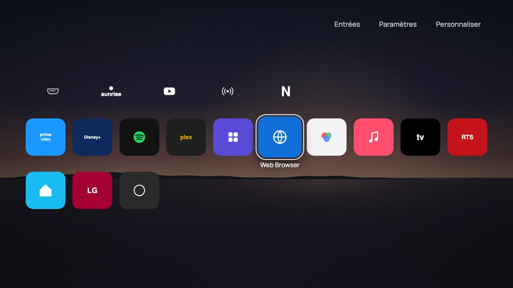
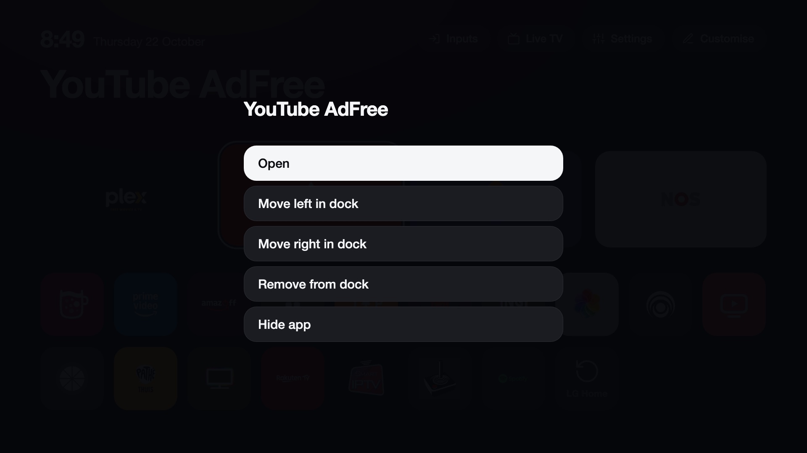
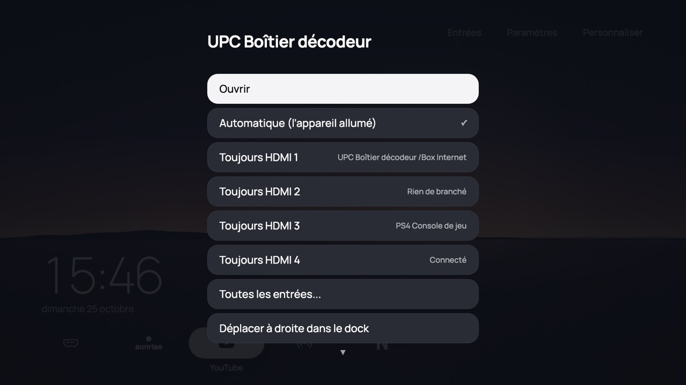
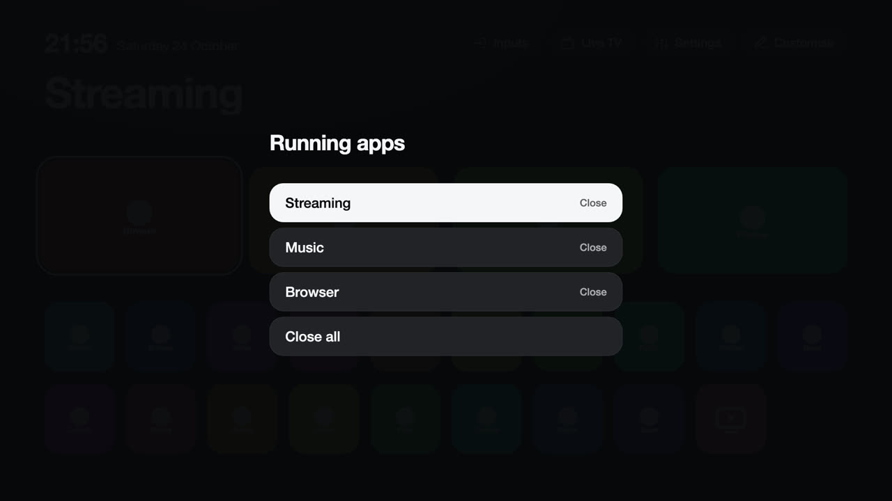
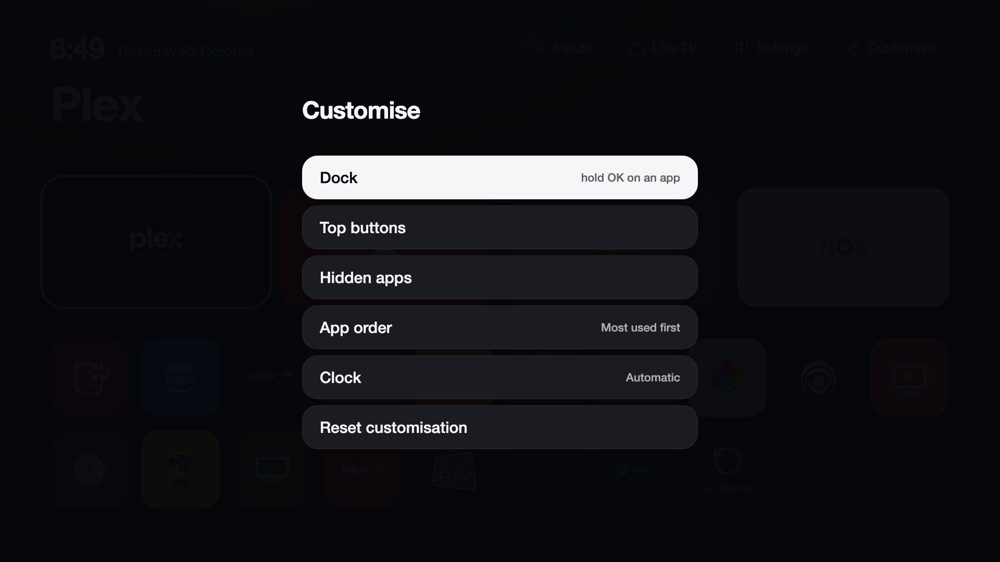
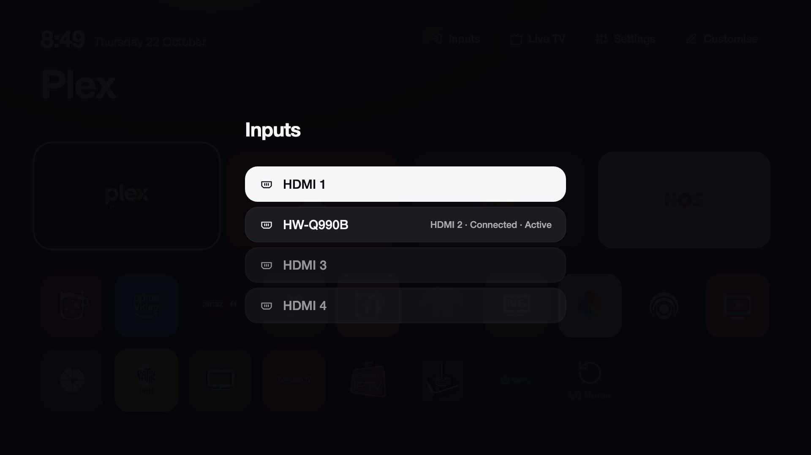

# The launcher

The launcher replaces LG's Home. It is a web page of the project that the TV's browser runs, so it starts fast and works the
same on every supported webOS version.

## The screen

With the default style, **Paysage**:

- **A lake at dusk** fills the screen, with a thin clock and the date resting on the water (Manrope, shipped with the launcher).
- **Dock.** One line of five white logos along the bottom, with no tiles around them. The focused one sits in a white pill (its logo
  turns dark) with its name under it. Until you change it, the dock holds the **HDMI card**, your TV app (Sunrise TV, Zattoo,
  blue TV, ...), **YouTube** and your **IPTV** player, found by their names, then the usual streaming apps.
- **White logos.** Each is made once from the app's own icon: its plain background is taken away and the rest turns white. An icon
  that is a picture, or nothing but background, shows the app's name instead.
- **All apps.** One press down: the line of logos moves up, the clock steps aside and every other app appears, sorted by how often
  you use each one (or A to Z). The focused app's name shows under it.
- **Top buttons.** Inputs, Settings and Customise as words; the focused one sits in a pill.

## Styles

**Customise** > **Style** switches the whole look at once, with nothing to download:

| Style | What it is |
|---|---|
| Paysage | The lake, the clock on the water and one line of white logos. The default. |
| Verre | Alpine peaks at blue hour and frosted-glass tiles with white logos; the focused tile grows and brightens. |
| Éditorial | Warm slate, a large serif clock and the apps set as words, with no icons; the focused name in italic over a hairline. |
| Lin | Warm linen, black type and paper-white cards with logos in ink; the focused card turns black. Bright in a dark room. |
| Aurore | A soft aurora that takes on the focused app's colour, a thin clock in the centre and glass pills. |
| Calm | Near-black, a large light clock and four dark cards; the focused card lights up in its app's colour. |
| Original | The original CleanYourTV look: the large name of the focused app, four wide tiles and ten columns. |

The manager app's **Theme** lists the same styles and the downloadable themes. Themes with the large name of the focused app at the
top (for example **Original**) show no names under the dock.

## Keys

| Action | How |
|---|---|
| Open an app | OK |
| Open the first, second, ... card of the dock | **1** to **9**, or the **red**, **green**, **yellow** and **blue** keys |
| App options (dock, hide) | Hold OK on an app |
| Remove a top button | Hold OK on it |
| Customise | The **Customise** button |
| Live TV | The **Live TV** button or tile |
| Switch input | The **Inputs** button |
| Close running apps | Back on the home screen |

The Magic Remote pointer works too: pointing and clicking, and holding the button on an app for its options.

## The HDMI card

OK on the HDMI card goes straight to the device that is on, without a list:

1. the input chosen in its options (hold OK: **Always HDMI 2**), else
2. the only input with a device that is on, else
3. of the inputs with a device on, the one you opened last from here, then the one the TV marks active.

When that still leaves a choice, the inputs are listed (devices that are on first) and your choice is remembered. The card is named
after the device (its HDMI-CEC name, or the name you gave the input in LG's settings) and shows its port, with a green dot while the
device is on. Hold OK on the card for **Automatic**, **Always HDMI 1** ... **4** and **All inputs**.

## Icon and name

Hold OK on an app and choose **Icon and name...** to draw it as YouTube, IPTV, TV, Films, Music or Sport instead of its own icon, or
to go back to **The app's own icon**. Two are automatic: **YouTube AdFree** (webosbrew) shows as YouTube, and an IPTV player
(Smart IPTV, SS IPTV, IPTV Smarters, OTT Navigator, Televizo, TiviMate, ibo Player, STB Emulator, ...) as IPTV. The Input key's picker
shows the same icons.

## Remote buttons

**Customise** > **Remote buttons** gives a button of the remote to an app or an HDMI input, for example the Netflix or Prime Video
button to Sunrise TV, or another one straight to the set-top box. It works from anywhere, not only on Home. The screen shows the taught
buttons as cards beside a drawing of the remote.

1. **Teach a button...**, then choose what it should open: the dock's apps come first, then the HDMI inputs by their device, then every
   app.
2. Press the button: the remote's app buttons pulse on the drawing while it waits. The first time, the button still does what LG made it
   do (Netflix opens): come back to Home, it is saved and the screen says so. From then on it opens your choice.

OK on a taught button changes its app or gives it back to LG; Back leaves the screen. Up to twelve buttons; teaching another button to the same app moves it.
The arrows, OK, Back, volume, mute, power and the buttons CleanYourTV already uses (Input, and the voice and Guide keys when set) are
never taken. It needs the input hook in LG's input service, like the Input key; without it the menu says so.

## Idle screen, night mode, weather

- **Idle screen.** After 3 minutes without a key on Home (or 10, or never: Customise > **Idle screen**), everything but the background
  and a dim clock fades away and the clock moves a little each minute, so no picture stays lit on an OLED. The first key only wakes it.
- **Night mode.** From 22:00 to 6:00 Home is a little darker and warmer (Customise > **Night mode** switches it off).
- **Weather.** Customise > **Weather** chooses a city; the temperature and the sky then show beside the date, from Open-Meteo
  ([Security](security.md#weather)). Off until a city is chosen.
- **The time of day.** Paysage's lake and Verre's peaks follow the day: dawn from 6:00, day from 9:00, dusk from 17:00, night from 21:00.
- **The HDMI card's name.** Hold OK on it > **Name...**: Décodeur, Box TV, Apple TV, PlayStation and others, or the device's own name.

## Running apps

Back on the home screen lists the apps that are open, as LG's Home does with its Recents on a second Back. OK closes an app,
**Close all** closes every app in the list, and Back leaves it. Closing an app also removes it from LG's recent apps.

It lists the apps the launcher knows, including the ones you hid from the grid; Home itself, CleanYourTV's own apps and the TV's
system apps are never in it. The list is read when it opens and closes when you leave Home. Suggested and first built by
[Steefzar](https://github.com/vincentnicod/calm-tv/issues/16).

## Customise

**Customise** holds:

- the **style** (Paysage, Verre, Éditorial, Lin, Aurore, Calm, Original),
- the **remote buttons** given to apps,
- the **idle screen**, **night mode** and the **weather**,
- the **top buttons** (add Inputs, Settings, Live TV or any app, or remove one),
- **hidden apps** (show them again),
- the **app order** (most used first, or A to Z),
- the **clock** format (automatic, 12 or 24 hour),
- **Reset customisation**.

The dock holds up to four apps. Hold OK on an app and choose **Add to dock**, **Move left**, **Move right** or **Remove from dock**.

## Inputs

The **Inputs** button lists HDMI inputs by the names LG shows, with what is connected and a marker on the active one. OK
switches to the input.

## Icons

Each tile uses the app's own icon. The tile colour is taken from the icon's edge colour, so an icon that reaches its edges blends
into the tile, and the ambient glow comes from the icon's most vivid colour. Colours are worked out once per app and remembered.

!!! note "Icons with a transparent margin"
    An icon that is an opaque square with a transparent margin around it (many LG icons) can look boxed in on its tile. A fix
    that fills the tile is available as a test build; see [Test builds](managing.md#test-builds).

## Language

Menus follow the TV's language: English, Dutch, German, French and Spanish.

## Themes

The look of the home screen (colours, tile and text size, columns, clock, glow, animation speed, wallpaper) is a [theme](themes.md),
chosen in the manager app.

## Settings file

Settings are stored on the TV in `/media/developer/cleanyourtv/config.json`:

| Key | Meaning |
|---|---|
| `dock` | App ids in the dock (up to four). |
| `topbar` | The buttons at the top. |
| `hidden` | App ids you hid. |
| `sort` | `usage` or `alpha`. |
| `clock` | `auto`, `12` or `24`. |
| `tiles` | How apps look: `{"<app id>": {"label": "IPTV", "icon": "iptv"}}`. Icons: `youtube`, `iptv`, `tv`, `film`, `music`, `sport`, or `""` for the app's own. |
| `hdmi` | The HDMI card: `auto` or a port, `"1"` to `"8"`. |
| `idle`, `night`, `weather` | The idle screen (`3`, `10` or `off`), night mode (`on` or `off`), the weather's city (`lausanne`, ...) or `off`. |
| `remap` | Remote buttons given to apps: `{"<button code>": "<app id>"}` (an input is `com.webos.app.hdmi1`). Set in Customise > Remote buttons. |

See [`config.example.json`](https://github.com/vincentnicod/calm-tv/blob/main/config.example.json). Change settings in
the launcher; the file is read and written by the service.
