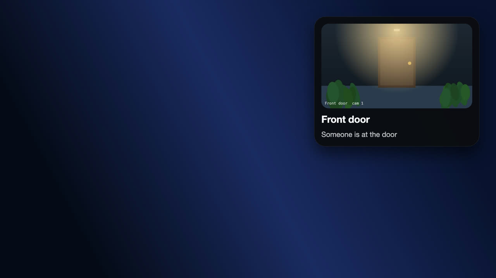
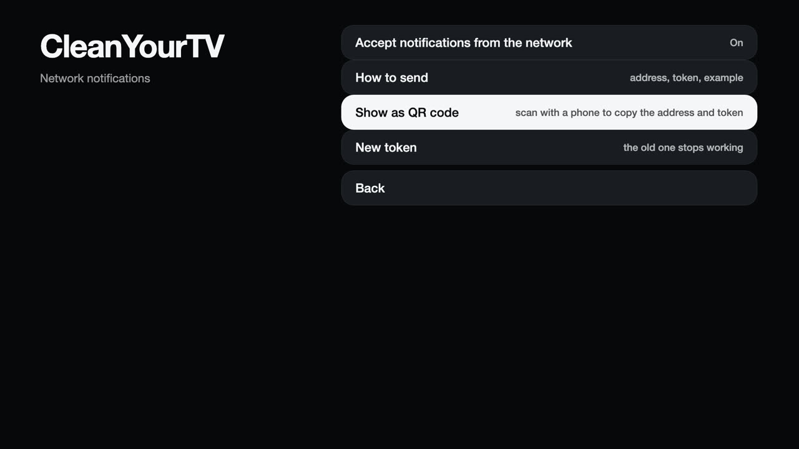
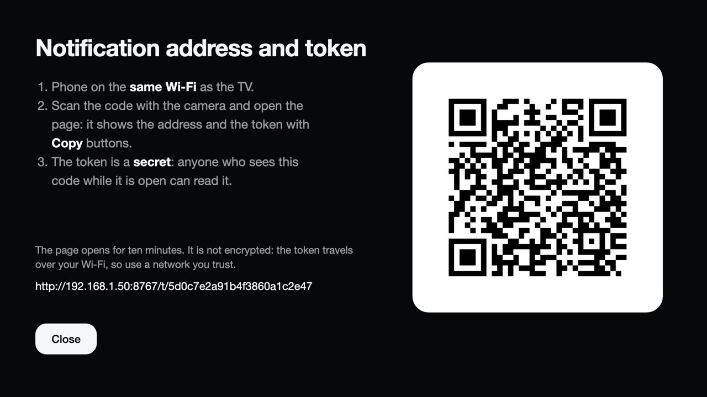
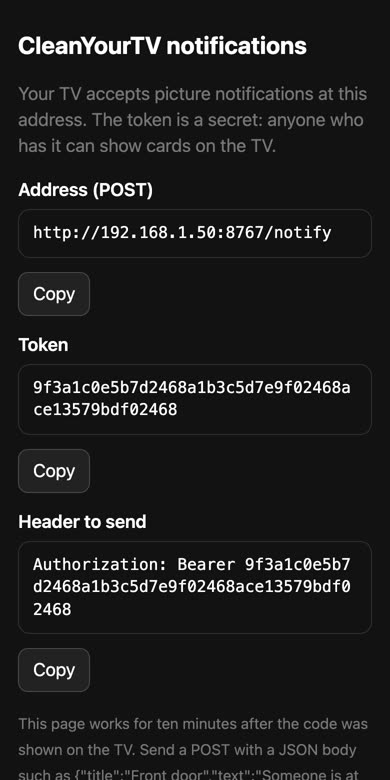

# Picture notifications

The `com.cleanyourtv.notify` app shows a card (picture, title, text) over whatever is on screen without taking the remote. Other
devices send it with a POST request, for example Home Assistant showing a camera snapshot when the doorbell rings.




The pictures on this page are rendered with made-up data (a made-up camera picture and a made-up token), not taken from a real TV or home.

## Enable it

In the manager app: **Network notifications** > **Accept notifications from the network**. It is off by default.



| Row | What it does |
|---|---|
| **How to send** | Shows the address, the token and an example request as text on the TV. |
| **Show as QR code** | Shows a QR code for your phone (below). |
| **New token** | Replaces the token; devices that use the old one stop working. |

!!! warning "The token is a secret"
    Anyone who has it and can reach the TV can show cards on its screen. **New token** replaces it.

## Get the address and the token on your phone

The token is 48 characters long. Instead of typing it, scan a QR code:

1. In the manager app choose **Network notifications** > **Show as QR code**.
2. Scan the code with the camera of a phone that is on the same Wi-Fi as the TV, and open the link.

   

3. The page shows the address, the token and the header to send, each with a **Copy** button. Paste them where you need them (for
   Home Assistant, see below).

   

The page is served by the TV itself at a random address (`/t/` and 24 random characters) on the notification port. It works for ten
minutes after the code was shown, then the address answers like any wrong request. It follows the same allow list as the notification
address (see below). It is plain HTTP like the notifications, so the token crosses your Wi-Fi unencrypted: use a network you trust and
close the screen on the TV when you are done.

## Sending one

```sh
curl -X POST http://192.168.1.50:8767/notify \
  -H "Authorization: Bearer <token>" -H "Content-Type: application/json" \
  -d '{"title":"Front door","text":"Someone is at the door","image":"http://192.168.1.20/snapshot.jpg","seconds":15,"position":"top-right"}'
```

| Field | Meaning |
|---|---|
| `title`, `text` | Up to 120 and 400 characters; either may be empty. |
| `image` | `http(s)` address of a picture, up to 6 MB. The TV downloads it, so the address must be reachable from the TV. If it cannot be fetched the card still appears and says why. |
| `seconds` | Display time, 2 to 120 (default 8). |
| `position` | `top`, `middle` or `bottom` plus `left`, `center` or `right` (default `top-right`). |

## Home Assistant

Add a `rest_command` (in `configuration.yaml`; keep the token in `secrets.yaml`, for example `cleanyourtv_bearer: "Bearer <token>"`):

```yaml
rest_command:
  cleanyourtv_notify:
    url: "http://192.168.1.50:8767/notify"
    method: POST
    headers:
      Authorization: !secret cleanyourtv_bearer
      Content-Type: "application/json"
    payload: >-
      {{ {"title": title | default(""), "text": text | default(""), "image": image | default(""),
          "seconds": seconds | default(10), "position": position | default("top-right")} | tojson }}
    timeout: 10
```

Then call it from an automation. This shows a camera picture when a sensor fires:

```yaml
actions:
  - action: rest_command.cleanyourtv_notify
    data:
      title: Front door
      text: Someone is at the door
      image: "http://homeassistant.local:8123{{ state_attr('camera.front_door', 'entity_picture') }}"
      seconds: 20
```

The camera's `entity_picture` carries a short-lived access token, which is valid right when the card is sent. The TV downloads the
picture, so use an address of Home Assistant that the TV can reach. Test with **Developer tools** > **Actions** in Home Assistant: a 401
means the token is wrong, a 403 means the allow list blocks Home Assistant's address.

## Limits and safety

- The port (default 8767) and an allow list of addresses are in `config.json` under `notifyApi`:
  `{"enabled":true,"port":8767,"allow":["192.168.1.0/24"]}` (prefixes /8, /16 and /24 are supported).
- Requests use **plain HTTP**, so the token is visible to anyone who can watch your network traffic. Keep the TV on a network you trust.
- Ten wrong tokens lock an address out for ten minutes, and at most 20 notifications a minute are accepted.
- From a shell on the TV, `POST localhost:8765/api/notify` accepts the same body without a token.

See [Security](security.md#network-notifications).
